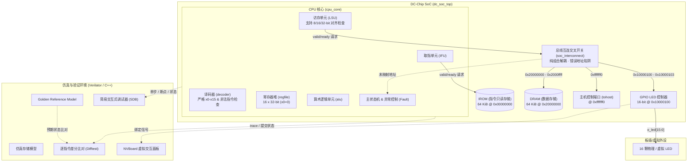

# DC-Chip (Digital Circuit Chip)

> 面向低功耗嵌入式控制与周期性传感任务的 RISC-V RV32E 处理器及微型片上系统 (SoC) 设计。

[](docs/isa/isa.md)
[](#)
[](docs/verification/plan.md)
[](sw/tests/)

---

## 目录

- [项目简介](#项目简介)
- [当前状态与里程碑](#当前状态与里程碑)
- [系统架构](#系统架构)
- [内存映射](#内存映射)
- [软件生态与运行时](#软件生态与运行时)
- [验证体系](#验证体系)
- [快速上手](#快速上手)
- [常用命令速查](#常用命令速查)
- [仓库目录布局](#仓库目录布局)
- [设计文档索引](#设计文档索引)
- [开发规范与贡献](#开发规范与贡献)

---

## 项目简介

**DC-Chip** 是数字电路设计课程设计项目，旨在通过渐进式的软硬件协同设计，在 **Xilinx Zynq-7020 FPGA**（PL 逻辑端）上实现一款高效、紧凑、面向“周期性采样、轻量计算、阈值判断、状态控制与通信”等嵌入式场景的处理器核及最小可用 SoC。

项目不单纯追求复杂的微架构特性（如过早引入乱序执行、多发射或庞大总线协议），而是遵循**工作负载驱动**与**全链路可复现闭环**原则，从 ISA 规范、RTL 实现、C++ 独立参考模型差分验证、自包含裸机运行时、外设驱动到图形化虚拟验证全面打通。

---

## 当前状态与里程碑

- **ISA 支持**：全面实现 **RV32E v1.0** 标准基础整数指令集（37 条通用整数指令，包括完整的算术运算、逻辑操作、移位、分支比较、跳转、加载与存储）。
- **寄存器与边界**：严格支持 `x0`--`x15` 共 16 个 32 位通用寄存器（`x0` 恒为 0）；译码器对任何引用 `x16`--`x31` 的指令均精确产生非法指令陷阱（Illegal Instruction Fault）。
- **存储子系统**：严格分离的 Harvard 架构，配备 64 KiB IROM（`0x00000000`）与 64 KiB DRAM（`0x20000000`），具备双通道独立握手与访存越界保护。
- **总线与外设**：自研组合解耦无环交叉开关（`soc_interconnect`）、跨时钟域总线桥（`mmio_cdc_bridge`，支持 FPGA 上外设 50MHz 固定时钟与 CPU 独立时钟）、外设路由器（`periph_interconnect`）与顶层微型 SoC（`dc_soc_top`）；完成 16 字节 FIFO MMIO UART（`0x10000000`）、16 位 GPIO LED（`0x10000100`）、Buttons（`0x10000200`）及八位十六进制七段数码管（`0x10000300`）集成。
- **软件与运行时**：构建自包含 Abstract Machine（AM）裸机运行时（`sw/am`），提供纯软件移位模拟的无除法硬件依赖 `udiv_mod`、全套格式化输出 `printf/sprintf`、`klib` C 标准库实现、`ioe` 设备抽象层以及自动化 ISA 合规审计脚本。
- **验证闭环**：
  - 12 个模块级自检单元测试（ALU, Decoder, Regfile, Core, LED, UART, Buttons, SEG7, Periph Interconnect, MMIO CDC Bridge, SoC Interconnect, SoC Top）。
  - 21 项自动化软件回归测试（6 项运行时机制测试 + 12 项 AM-kernels 经典基准测试 + 3 项外设自检）。
  - Verilator C++ 独立 Golden Reference Model 逐指令差分测试（Difftest）。
  - 交互式简易调试器（SDB，支持单步、断点、内存与寄存器扫描）及 VCD 波形追踪。
  - NVBoard 虚拟外设图形化仿真平台支持（16 颗虚拟 LED、UART 终端、Buttons 与八位七段数码管）。

> [!NOTE]
> 真实的 Zynq-7020 板卡综合、实现、管脚约束与上板验证属于后续规划子阶段。在板卡物料与电气规范最终冻结前，不将未经测量的综合时序与功耗推断为事实。FPGA 目标固定外设时钟为 50 MHz，CPU 与片上存储处于独立时钟域。

---

## 系统架构

DC-Chip 采用经典单发射、顺序执行、无复杂流水冒险的微架构设计，配合解耦的取指单元（IFU）与访存单元（LSU），并通过总线互连交叉开关连接片上存储与 MMIO 外设。



---

## 内存映射

DC-Chip 采用统一的 32 位小端字节寻址模型，物理地址映射如下：

| 区域 | 地址范围 | 容量 | 属性 | 描述与约束 |
| :--- | :--- | :---: | :---: | :--- |
| **IROM** | `0x00000000` -- `0x0000ffff` | 64 KiB | 只读 / 可执行 (RX) | 取指专属存储。仅允许 IFU 四字节对齐取指；LSU 访问将触发 Access Fault。 |
| **MMIO 总空间** | `0x10000000` -- `0x1000ffff` | 64 KiB | 读 / 写 (RW) | 外设寄存器统一编址空间。未映射子空间访问触发 Access Fault。 |
| ↳ **MMIO UART** | `0x10000000` -- `0x1000000f` | 16 字节 | 读 / 写 (RW) | TX(0x0, WO), RX(0x4, RO), STATUS(0x8, RO)。内置 16 字节 FIFO，50MHz/115200bps。 |
| ↳ **GPIO LED** | `0x10000100` -- `0x10000103` | 4 字节 | 读 / 写 (RW) | 低 16 位映射到 16 颗 LED 输出，高 16 位保留。支持字节/半字/字访问。 |
| **DRAM** | `0x20000000` -- `0x2000ffff` | 64 KiB | 读 / 写 (RW) | 软件运行期数据存储（支持 `.data`, `.bss`, 堆与栈）。禁止 IFU 取指。 |
| **Host I/O** | `0xfffffff0` -- `0xfffffff3` | 4 字节 | 只写 (WO) | 仿真主机交互端口（`tohost`），供测试程序传递通过/失败退出码。 |

---

## 软件生态与运行时

仓库内自包含一套轻量级 **AM (Abstract Machine)** 运行时环境（位于 [`sw/am/`](sw/am/)）：

1. **启动与运行时管理**：
   - [`sw/am/src/trm.c`](sw/am/src/trm.c)：实现 `_start` 汇编入口、栈指针 `sp` 初始化（初始指向 DRAM 顶端 `0x20010000`）、堆边界 `heap` 设置、`halt()` 退出处理以及基于 MMIO UART 硬件等待的 `putch(char ch)`。
2. **基础 C 标准库 (`klib`)**：
   - 包含常用的高频函数：`memset`, `memcpy`, `memcmp`, `strlen`, `strcmp`, `strncmp`, `strcpy`, `strncpy`, `strcat`。
   - 包含自包含的纯软件移位模拟除法 `udiv_mod`（消除对 RISC-V M 扩展的依赖），并完整实现 `printf`, `sprintf`, `snprintf`, `vsprintf`, `vsnprintf`。
3. **设备抽象接口 (`ioe`)**：
   - [`sw/am/include/amdev.h`](sw/am/include/amdev.h)：提供标准外设结构体定义（`AM_GPIO_LED`, `AM_GPIO_SEG7`, `AM_UART_CONFIG`, `AM_UART_TX`, `AM_UART_RX`）。
   - [`sw/am/src/ioe.c`](sw/am/src/ioe.c)：提供外设抽象操作，封装便捷 API `led_write`, `led_read`, `seg7_show_hex`, `uart_write`, `uart_read`。
4. **ISA 自动化合规检查**：
   - 每次编译软件生成目标二进制后，自动运行 [`scripts/check_isa_subset.py`](scripts/check_isa_subset.py) 反汇编核对，确保程序未包含未实现的扩展指令或越界寄存器。

### 21 项软件回归测试套件

| 类别 | 测试程序名 | 测试内容与目标 |
| :--- | :--- | :--- |
| **运行时机制测试** | `calc_add` | 基础算术与累加自检 |
| | `jump_table` | 函数指针跳转表与复杂控制流 |
| | `trm_smoke` | TRM 最小运行时与环境初始化 |
| | `trm_exit_code` | 仿真退出码传递通道验证 |
| | `dram_access` | 各种位宽的 DRAM 读写一致性自检 |
| | `heap_smoke` | 动态内存分配与堆指针行为验证 |
| **AM-Kernels 基准** | `cpu_add` | 符号数与无符号数进位加法运算 |
| | `cpu_bit` | 位运算（按位与/或/异或/移位操作） |
| | `cpu_bubble_sort` | 冒泡排序算法 |
| | `cpu_dummy` | 最小程序空循环与提交测试 |
| | `cpu_fib` | 斐波那契数列递推计算 |
| | `cpu_if_else` | 深度多重分支选择逻辑 |
| | `cpu_leap_year` | 闰年计算条件逻辑判断 |
| | `cpu_load_store` | 密集复杂 Load/Store 访存边界测试 |
| | `cpu_recursion` | 递归函数调用与深层调用栈保护 |
| | `cpu_select_sort` | 选择排序算法 |
| | `cpu_string` | `klib` 字符串库全套函数集成自检 |
| | `cpu_sub_longlong` | 64 位长整数减法与借位运算 |
| **外设与交互测试** | `led_marquee` | 16 位跑马灯流转、自检与 GPIO LED 读写闭环 |
| | `uart_hello` | MMIO UART 字符发送、`printf`、`sprintf`、状态位自检与 LED 协同 |
| | `seg7_hex` | SEG7 AM API、32 位 MMIO 读回、byte lane 与 LED 协同 |

---

## 验证体系

DC-Chip 构建了多层次、防御性的严密验证闭环：

1. **RTL 单元自检 (Icarus Verilog)**：
   - 覆盖 ALU、译码器、寄存器堆、CPU 核心、LED 控制器、互联开关与 SoC 顶层，具备自包含的测试激励与断言。
2. **独立 Golden Reference Model 与 Difftest**：
   - 使用 C++ 构建完全独立的 RV32E 参考执行模型（[`sim/verilator/reference_model.cpp`](sim/verilator/reference_model.cpp)）。
   - 在 Verilator 仿真运行时，处理器核每成功提交一条指令，Difftest 模块比对 RTL 状态与 Golden Model 的寄存器状态及 PC。一旦出现差异，立即触发断言并保存诊断上下文。
3. **简易调试器 (SDB)**：
   - 内置命令行调试工具，支持命令：
     - `si [N]`：单步执行 N 条指令
     - `info r`：打印当前全部 16 个寄存器值及 PC
     - `x N ADDR`：以十六进制扫描显示指定内存地址处的内容
     - `c`：全速持续运行直至遇到断点或退出
4. **NVBoard 虚拟交互板卡**：
   - 集成图形化外设框架，支持在 Verilator 仿真时通过 SDL2 实时查看 16 颗 LED 的点亮与跑马灯效果。

---

## 快速上手

### 1. 安装环境依赖

开发与仿真环境推荐基于 **Ubuntu 22.04 LTS / 24.04 LTS** 或兼容 Debian 发行版：

```bash
sudo apt-get update
sudo apt-get install -y \
    build-essential \
    verilator \
    iverilog \
    python3 \
    gcc-riscv64-linux-gnu \
    binutils-riscv64-linux-gnu \
    libsdl2-dev \
    libsdl2-image-dev \
    libsdl2-ttf-dev
```

### 2. 检查工具链就绪

在项目根目录运行工具检查：

```bash
make check-tools
```

### 3. 一键完整回归

先用帮助与测试索引确认公开入口：

```bash
make help
make list
```

运行包含单元测试、差分测试、21 项软件基准测试与仿真闭环的完整回归：

```bash
make test
```

该命令在 `build/test-fixtures/full-regression/` 中使用默认 defconfig 隔离运行，
不会读取或修改本地 `.config`。全部测试通过时将显示各阶段 PASS。

---

## 常用命令速查

### 配置管理 (Kconfig)

```bash
make defconfig       # 生成默认配置 (.config)
make menuconfig      # 进入图形化终端菜单配置
make config-show     # 查看当前生效的配置项
```

### 软件编译与测试

```bash
make sw                              # 只编译全部 21 项软件镜像
make sw tests list                   # 查看软件测试清单
make sw tests                        # 完全按 .config 运行全部软件测试
make sw tests ALL=cpu_fib,uart_hello # 只运行指定软件测试
make sw tests sdboff waveoff ALL=cpu_fib # 临时关闭指定运行时功能
make sw tests batch                  # 等价于 sdboff nvboardoff waveoff
make sw demo list                    # 查看交互式演示清单
make sw demo build                   # 构建演示镜像
make sw demo run                     # 打开 NVBoard UART LED 演示
```

### 分层测试

```bash
make list                            # 测试总入口
make testunit list                   # 查看 RTL 单测与 lint 清单
make testunit                        # 运行默认硬件测试集
make testunit ALL=alu,uart,core      # 运行指定硬件测试
make testinfra list                  # 查看仿真基础设施测试清单
make testinfra                       # 运行默认基础设施测试集
make testinfra ALL=memory,reference  # 运行指定基础设施测试
make test                            # 运行默认三层完整回归
```

### 仿真运行与调试

```bash
# 按 .config 构建唯一的 Verilator 仿真器
make sim-build

# SDB、NVBoard、VCD 与 Difftest 是 .config 中的构建期开关
make menuconfig
make sw tests ALL=led_marquee       # 构建检查后按配置运行
make sw tests batch ALL=uart_hello  # 自动模式仍保留 difftest
make testinfra ALL=difftest-engine,wave,sdb,unified-sim
```

### 清理生成物

```bash
make clean           # 清理日常构建产物，保留 .config 与 build/tools
make tools-clean     # 清理外部重型工具产物
make distclean       # 删除 build/、.config 与 .config.old
make mrproper        # distclean 的同义入口
```

---

## 仓库目录布局

```text
DC-Chip/
├── rtl/                        # 可综合 RTL 源代码 (SystemVerilog)
│   ├── core/                   # CPU 核心 (ALU, 译码器, 寄存器堆, CPU 顶层)
│   ├── periph/                 # 外设模块 (LED 控制器等)
│   └── soc/                    # SoC 互连开关及 SoC 顶层 (dc_soc_top)
├── sim/                        # 仿真与验证基础设施
│   ├── tb/                     # 模块级 testbench (Icarus Verilog)
│   ├── tests/                  # 针对仿真器与参考模型的 C++ 测试用例
│   └── verilator/              # Verilator 顶层、仿真存储、Difftest、SDB、参考模型
├── sw/                         # 裸机软件生态
│   ├── am/                     # 自包含 Abstract Machine 运行时与 klib
│   ├── tests/                  # 21 项软件回归测试程序源代码
│   └── demo/                   # 面向展示的交互式软件演示
├── constr/                     # 引脚与物理约束 (包括 NVBoard 虚拟引脚映射)
├── configs/                    # 预置 Kconfig 配置文件
├── scripts/                    # 构建管理、配置生成与 ISA 审计脚本
├── docs/                       # 体系结构规范、ISA 手册与设计文档
├── tools/                      # 辅助工具脚本与依赖 (Kconfiglib 等)
├── Makefile                    # 统一构建与测试入口
├── AGENTS.md                   # 代理与开发者协作规约
└── GIT_RULES.md                # Git 提交与版本管理纪律
```

---

## 设计文档索引

深入了解 DC-Chip 的设计规格与决策，请参考以下专项文档：

- [项目需求与交付规格](docs/requirements.md) (`docs/requirements.md`)：定义设计目标、工作负载与阶段验收准则。
- [ISA 体系结构规范](docs/isa/isa.md) (`docs/isa/isa.md`)：RV32E 规范源，详细记录指令编码、操作数格式与异常行为。
- [微架构与接口契约](docs/architecture/microarchitecture.md) (`docs/architecture/microarchitecture.md`)：数据通路、状态转移、valid/ready 握手时序及 Fault 机制。
- [地址与存储模型](docs/architecture/memory-map.md) (`docs/architecture/memory-map.md`)：存储区域划分、Harvard 隔离原则与 MMIO 寄存器定义。
- [软硬件 ABI 契约](docs/architecture/software-abi.md) (`docs/architecture/software-abi.md`)：栈布局、调用规约与裸机环境约定。
- [全链路验证方案](docs/verification/plan.md) (`docs/verification/plan.md`)：单元测试、差分测试、基准套件与验收策略。
- [FPGA 板级规划](docs/fpga/board.md) (`docs/fpga/board.md`)：Zynq-7020 板卡规格、时钟复位管理与引脚规划（待决项清单）。

---

## 开发规范与贡献

1. **规格先行**：任何硬件逻辑或软件 ABI 的变更，必须先在 `docs/` 下的对应规范文档中更新并冻结，严禁在实现中引入未记录的隐式行为。
2. **Git 操作纪律**：提交前必须查阅并遵守 [`GIT_RULES.md`](GIT_RULES.md)；仓库配置了 `.githooks/pre-commit` 自动门禁，严禁向版本库提交敏感信息、日志、波形及临时构建产物。
3. **回归验证**：在提交代码变更前，确保运行 `make test` 且全部测试项保持 PASS。
