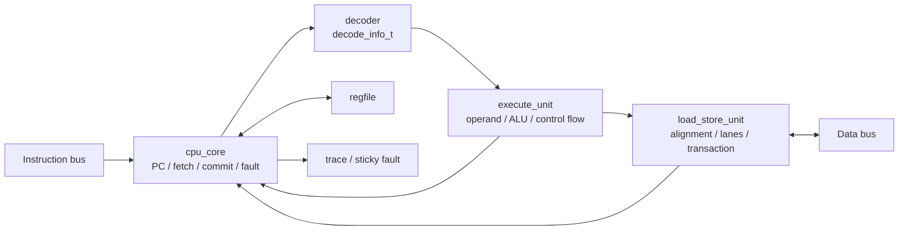
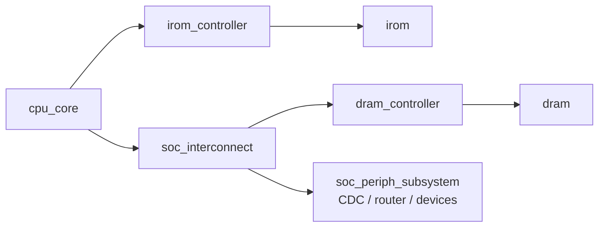

# DC-Chip 微架构与可观察协议

本文是 CPU、存储总线、提交与 fault 行为的唯一规范源；指令语义见
[`../isa/isa.md`](../isa/isa.md)，地址和设备副作用见
[`memory-map.md`](memory-map.md)。实现状态不在此维护。

## 1. 执行模型

`cpu_core` 是顺序、单发射、非流水核心。同一时刻最多处理一条未提交指令，
程序顺序与提交顺序一致，不推测取指或执行。取指通道和数据通道各最多一个在途
事务；load/store 完成前核心停顿。

控制状态为取指请求、取指等待、数据请求、数据等待和粘滞 fault。无访存指令在
执行完成时提交；访存指令只在数据响应成功握手时提交。实现不承诺固定 CPI。

```text
PC -> fetch handshake -> instruction register -> decoder -> regfile -> execute
                                                        |          |
                                                        |          +-> branch/jump
                                                        +-> LSU -> data handshake
commit/trace/fault <- controller <- writeback <--------------------+
```

核心内部按职责划分为以下模块；这些边界不改变 `cpu_core` 的公开端口或周期协议：



- `decoder` 将指令一次性转换为 `decode_info_t`，负责 RV32E 寄存器边界、立即数、
  操作数选择、写回、访存和控制流分类；后级不再从原始 opcode 反向推断用途。
- `execute_unit` 是组合执行边界，包含 operand mux、`alu`、分支比较、跳转目标、
  下一 PC、普通写回值和实际控制流目标对齐检查。
- `load_store_unit` 独占数据事务状态和请求上下文，负责地址对齐、size、store
  lane/strobe、load lane/扩展、访问错误分类及 `skip_ref` 传播。请求接受前 payload
  保持稳定，reset 放弃旧事务并拒绝迟到响应。
- `cpu_core` 只仲裁取指、LSU 完成、架构状态提交与粘滞 fault；非访存在取指响应
  拍提交，访存仍只在成功数据响应拍提交。

核心使用单一 `clk` 和同步高有效 `rst`。板级输入如何同步、转换极性和释放复位由
FPGA wrapper 处理，当前信息见 [`../fpga/board.md`](../fpga/board.md)。

## 2. valid/ready 通用契约

请求在 `req_valid && req_ready` 的上升沿被接收，响应在
`rsp_valid && rsp_ready` 的上升沿被接收。

- 发送方在 valid 为 1 且尚未握手时保持全部 payload 稳定。
- 请求被接受不等于响应完成；每个请求只能匹配一次响应。
- 响应可背压；等待时核心不得重复请求、提交或改变对应架构状态。
- 所有 store 也必须收到完成响应；错误响应表示目标未产生任何部分或完整写入。
- reset 前已握手但未完成的事务被放弃；系统边界必须冲刷或丢弃迟到响应，不能
  与 reset 后请求配对。

## 3. 取指通道

| 方向 | 信号 | 语义 |
| --- | --- | --- |
| output | `imem_req_valid`, `imem_req_addr[31:0]` | 四字节对齐的取指请求 |
| input | `imem_req_ready` | 请求接收 |
| input | `imem_rsp_valid`, `imem_rsp_rdata[31:0]`, `imem_rsp_error` | 指令响应与 access fault |
| output | `imem_rsp_ready` | 核心接收响应 |

取指错误直接形成 instruction access fault，响应数据不得译码。当前指令提交或
fault 前不发出下一条取指，因此没有需 flush 的推测响应。

## 4. 数据通道

| 方向 | 信号 | 语义 |
| --- | --- | --- |
| output | `dmem_req_valid`, `dmem_req_addr[31:0]` | 数据请求与 byte address |
| output | `dmem_req_write`, `dmem_req_size[1:0]` | load/store 与 byte/half/word 宽度 |
| output | `dmem_req_wdata[31:0]`, `dmem_req_wstrb[3:0]` | lane 对齐写数据和 byte enable |
| input | `dmem_req_ready` | 请求接收 |
| input | `dmem_rsp_valid`, `dmem_rsp_rdata[31:0]`, `dmem_rsp_error` | 完成响应、读数据与错误 |
| input | `dmem_rsp_skip_ref` | 响应来自需要差分同步的 MMIO 边界 |
| output | `dmem_rsp_ready` | 核心接收响应 |

`size=00/01/10` 分别表示 byte/halfword/word。lane、对齐与扩展规则由
[`memory-map.md`](memory-map.md) 定义。核心在发请求前发现未对齐；错误响应
按 load/store 类型形成 access fault。

## 5. 提交与控制流

`trace_valid` 表示一条指令的全部体系结构效果在同一上升沿可见，且每条成功指令
只报告一次。`trace_pc` 和 `trace_inst` 是提交指令的旧 PC 与完整指令字。

| 类别 | 提交条件 | 提交效果 |
| --- | --- | --- |
| 算术/逻辑/LUI/AUIPC/FENCE | 合法译码并完成执行 | 可选写回；PC 前进 4 |
| 条件分支 | 合法且实际目标对齐 | 按条件选择目标或 PC+4 |
| JAL/JALR | 实际目标对齐 | 写回旧 PC+4；更新 PC |
| load | 成功数据响应 | 写回扩展后的值；PC 前进 4 |
| store | 成功数据响应 | 写副作用完成；PC 前进 4 |
| 任一 fault | 永不提交 | 无寄存器、PC 或目标写副作用 |

写 `x0` 被忽略，但指令的访存、控制流和 fault 行为仍执行。JALR 使用旧 `rs1`
计算目标，并在目标对齐确认后与 link 写回同时提交。

## 6. fault 契约

| cause | 含义 |
| ---: | --- |
| 1 | illegal instruction |
| 2 | instruction access fault |
| 3 | instruction address misaligned |
| 4 | load address misaligned |
| 5 | load access fault |
| 6 | store address misaligned |
| 7 | store access fault |

`fault_valid` 在检测沿锁存并保持到 reset；`fault_pc` 指向 fault 指令。
`fault_inst_valid` 只在指令已成功取回时为 1，此时 `fault_inst` 有效。fault 状态
期间不发请求、不接响应、不提交。一次指令先做本地对齐检查，再发总线请求，因此
同一访问不会同时报告 misaligned 与 access fault。

## 7. trace、调试与差分边界

- `debug_reg_addr[3:0]` / `debug_reg_data[31:0]` 提供 `x0`--`x15` 索引读取，只用于
  验证可见性，不参与执行。
- 普通提交令独立参考模型执行同一指令，并比较提交 PC、指令、下一 PC 和全部
  架构寄存器。
- 数据响应的 `dmem_rsp_skip_ref` 在对应访存提交拍导出为 `trace_skip_ref`。该位
  只用于成功提交的 MMIO 访问：difftest 仍检查提交 PC，并将受影响的 DUT
  结果同步到参考模型；它不是忽略任意差异的通用开关。
- `tohost` 是仿真私有终止通道，不标记 `skip_ref`。

## 8. SoC 路由与 CDC

`dc_soc_top` 是自包含 composition root，实例化总线级 `dc_soc_subsystem`、两个
存储 controller 和 IROM/DRAM 叶子。`dc_soc_subsystem` 只包含 `cpu_core`、
`soc_interconnect` 与 `soc_periph_subsystem`；后者收拢 CDC、外设路由以及
UART/LED/Buttons/SEG7 controller。取指只连接 IROM。LSU 经 `soc_interconnect`
把 DRAM/`tohost`、MMIO 和未映射错误分流。



`irom_controller` 检查 64 KiB 范围和四字节对齐，将 byte address 转为 14-bit word
index，并保持异步读和可同拍完成的取指响应。`dram_controller` 每次保存一个在途
事务，保持背压响应稳定，并只在成功响应握手沿向 DRAM 叶子发出 byte write
enable 或提交 `tohost`。reset 丢弃尚未完成的事务。

行为叶子 `irom(clk,a,spo)` 和 `dram(clka,addra,dina,wea,douta)` 分别实现异步 ROM
读与单时钟同步 read-first DRAM。Verilator source set 编译带 DPI-C 的行为叶子；
未来 Vivado source set 必须排除它们，并提供模块名、端口、16K×32 深度、DRAM
四路 byte write enable 和 read-first 时序完全相同的 IP。不得在 SoC RTL 中用隐式
延时补偿 IP 配置差异。`ENABLE_TOHOST=0` 时仿真私有地址只返回 access error。

`mmio_cdc_bridge` 有两种参数化实现：

- `ASYNC_CDC=0`：同一时钟环境的组合直通，用于默认仿真；
- `ASYNC_CDC=1`：CPU 与外设时钟域间的 toggle-handshake，payload 在事务期间
  锁存，toggle 经 2FF 同步，每个方向最多一个在途事务。

异步模式保证协议传输，但不替代板级 reset-domain crossing、时钟约束或静态 CDC
分析。任何增加流水、预取、多个在途事务或 ID 的实现都必须先修订本文的提交、
flush、取消和配对规则。
