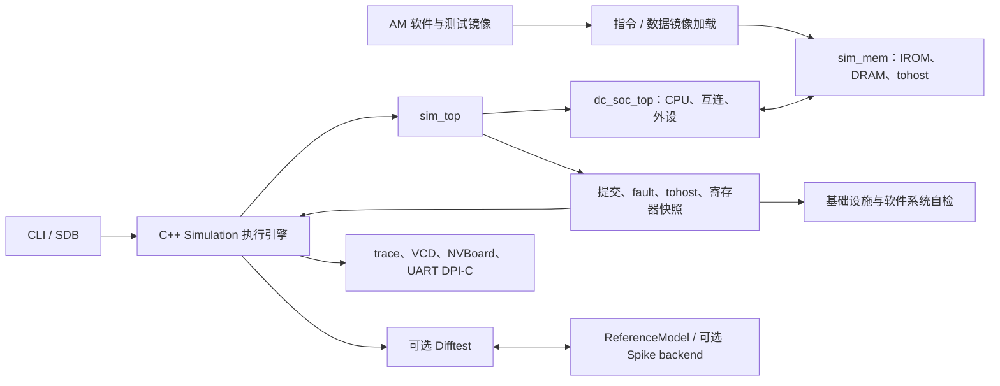

# 仿真体系设计

本文面向维护者，说明当前 behavioral simulation 的分层、运行数据流和扩展
边界。它不定义镜像格式、命令行、退出码或 Kconfig 默认值；这些外部契约分别以
[`simulator.md`](simulator.md) 与 [`configuration.md`](configuration.md) 为准。
验证层次和公开测试入口以 [`plan.md`](plan.md) 为准，CPU、总线、提交与 fault
语义以 [`../architecture/microarchitecture.md`](../architecture/microarchitecture.md)
为准。

## 1. 目标与边界

仿真体系以一个可配置的 Verilator 可执行文件为中心，在完整 SoC 上运行指令和
数据双镜像，并提供可重复的终止、状态观测和逐提交差分验证。SDB、VCD、NVBoard
和 UART 字符镜像是同一执行引擎上的可选观测能力，不产生分叉的 DUT 或执行路径。

宿主文件加载、DPI-C、终端输出、GUI 和波形输出只存在于仿真边界。CPU、SoC 与
外设 RTL 不依赖宿主文件系统或调试工具，因此可综合设计仍有独立的实现路径。

## 2. DUT 封装与执行循环

`sim_top` 只负责把 `dc_soc_top` 接到仿真私有内存模型，并导出提交、调试寄存器、
fault、`tohost` 和外设可观测信号。`sim_mem` 分别模拟 IROM 与 DRAM，保持 Harvard
双镜像边界；仿真私有 `tohost` 用于把 guest 退出结果交给宿主。地址、容量、权限和
副作用不在本文重述，均由 [`../architecture/memory-map.md`](../architecture/memory-map.md)
定义。

C++ `Simulation` 拥有 Verilated context 与顶层实例。调用方必须先完成一次 reset；
reset 保持两个完整周期后释放。每个 `step_cycle()` 按高、低半周期推进时间，采样
一次提交事件并累计 cycle/commit 计数。`step_instruction()` 则持续推进到下一次
提交或终止事件，因而“单步”以提交而非固定周期定义。

执行循环把 fetch PC/指令、`x0`--`x15`、cycle、commit 和仿真时间组成架构快照，
供 SDB、最终状态检查与监视器使用。它在 guest `tohost` 退出、首次进入 fault、
监视失败、断点、请求的执行额度或 timeout 时停止；这些停止条件的精确优先级和
宿主退出码由 [`simulator.md`](simulator.md) 定义。

## 3. 差分与可观察性

启用 `DC_SIM_DIFFTEST` 时，公共执行循环在每个已提交指令上驱动 Difftest。默认
backend 是仓库内独立的 C++ `ReferenceModel`；动态库 backend 可接入可选 Spike
适配器。初始化时参考端取得与 DUT 一致的内存和架构起点；普通提交比较提交 PC、
指令、下一 fetch PC 与全部 RV32E 架构寄存器。fault 还必须在发生时刻、cause 与
PC 上一致，双方同时 fault 不表示 guest 成功。

MMIO 事务不要求参考模型复现外设状态机，因此只允许已提交的 MMIO 访存发出
`is_skip_ref`。该路径仍检查提交 PC 和全部寄存器；load 同步目标寄存器，其余
事务同步下一 PC。DRAM 与仿真 `tohost` 不得使用该跳过路径。改变这一边界必须同步
更新微架构协议、参考模型、测试和 ADR。

调试能力只观察或驱动仿真边界：SDB 使用执行引擎的单步、快照和断点接口；VCD
记录同一 Verilator 实例，运行时开关不改变架构状态；NVBoard 在低电平阶段刷新
绑定引脚；UART DPI-C 仅镜像字符输出。构建期是否编入这些能力及运行期关闭方式由
[`configuration.md`](configuration.md) 和 [`simulator.md`](simulator.md) 定义。

## 4. 验证闭环与维护规则

| 验证层 | 对仿真体系的覆盖 |
| --- | --- |
| RTL 单元与 lint | 模块协议、存储、外设、CDC 和 SoC 的白盒自检 |
| 仿真基础设施 | 镜像内存、反汇编、参考模型、执行引擎、difftest、CLI、SDB 与 VCD 的自检 |
| 软件系统 | 真实 RV32E 镜像在完整 SoC 上的启动、运行时、算法、MMIO 与 ISA 回归 |
| 完整默认回归 | 隔离 default defconfig 下的上述默认集合 |

测试名称和当前数量是动态信息，只能通过 `make list` 及各层 `list` 子命令查询。
修改执行引擎、观察接口或差分边界时，先运行受影响的 `testinfra` 项；变更公开
契约、配置或构建规则后再运行完整回归。波形、日志和测试夹具均应留在 `build/`，
不纳入版本控制。

本体系提供的是 RTL lint 与 behavioral simulation 证据。Verilator、difftest、SDB
或 NVBoard 通过均不构成综合、实现、时序、资源、功耗或真实上板验证；这些证据的
当前状态以 [`../status.md`](../status.md) 为准。
